# Heisenbudget

<p align="center">
  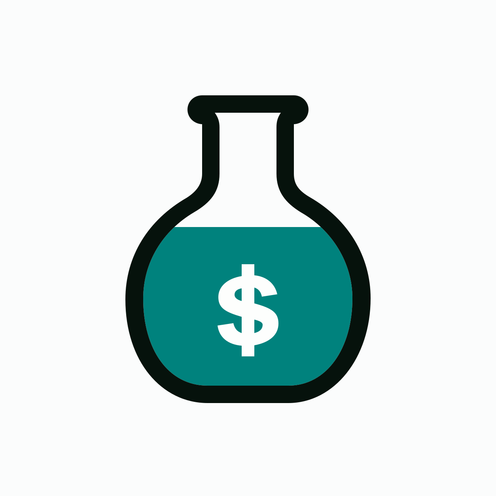
</p>

<p align="center">
  <strong>Your money, measured. Simple, private, offline.</strong><br/>
</p>

<p align="center">
  <a href="https://github.com/ajwadtahmid/heisenbudget/releases">
    
  </a>
  <a href="https://flutter.dev">
    
  </a>
  
  
  
</p>

---

<div align="center">

<a href="https://github.com/ajwadtahmid/heisenbudget/releases">
</a>

<a href="https://play.google.com/store/apps/details?id=com.ajwadtahmid.heisenbudget">
</a>

<span>iOS listing coming soon</span>

</div>

---

## Overview

A personal expense and income tracker for Android and iOS, with a light
chemistry-lab look. Log what comes in and goes out, keep to budgets, save
towards goals and read your months back as charts and a month-end report. It
works **100% offline**: no accounts, no internet, no cloud, no analytics.
Everything is stored on your phone, and the app has no server of its own.

> **Disclaimer:** Independent project. The name is a pun on a physicist's name.
> Not affiliated with or endorsed by any TV show, film or their owners.

## Table of Contents

- [Key Features](#key-features)
- [Screenshots](#screenshots)
- [Features](#features)
- [Development](#development)
- [Data & Privacy](#data--privacy)
- [Support & Feedback](#support--feedback)
- [Changelog](#changelog)
- [Credits & Acknowledgments](#credits--acknowledgments)
- [FAQ](#faq)
- [Known Limitations](#known-limitations)

---

## Key Features

- **See where it goes**: Your balance and Received, Spent and Net for any period, a ruler showing how far through the period you are, and a spectrum chart of spending by category. Tap a peak for the exact share.

- **Log it fast**: Add income or expenses from one sheet, with an optional title, note and category. Favorites, Duplicate and repeating transactions cover the entries you make over and over.

- **Stay on budget**: A limit for any expense category, or for all spending, per month or a length you choose. See what is left, the days left and about how much you can spend a day.

- **Save for goals**: Targets with an optional date and an icon. Put money in or take it out, see your pace and what a date asks of each month. Goals are numbered by priority and kept apart from your balance.

- **Understand the months**: Insights shows money in and out for 3, 6 or 12 months, the share you kept, one category over time and what moved most. A month-end report reads each finished month back to you.

- **Yours to keep**: Back up everything to one file, restore it on any phone or export a CSV. Nothing leaves the phone unless you send it.

- **Made to read**: Dark, light or follow the phone, five accent colours, four fonts, and a layout that holds up at large text sizes and with screen readers.

---

## Screenshots

| Home | Budgets | Insights | History | Settings |
|------|---------|----------|---------|----------|
| 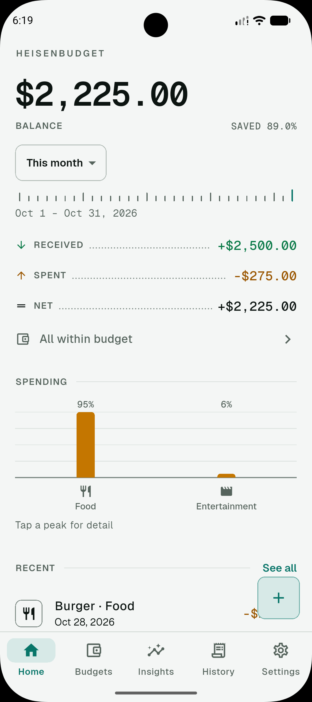 | 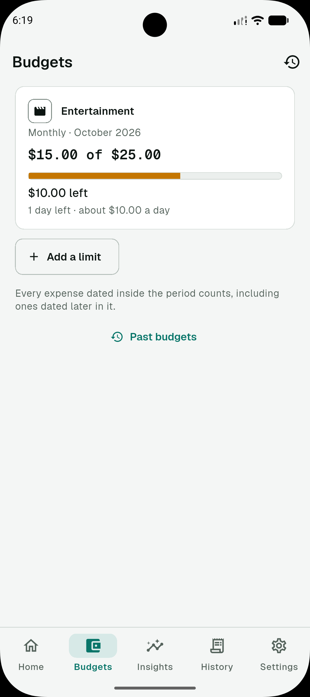 | 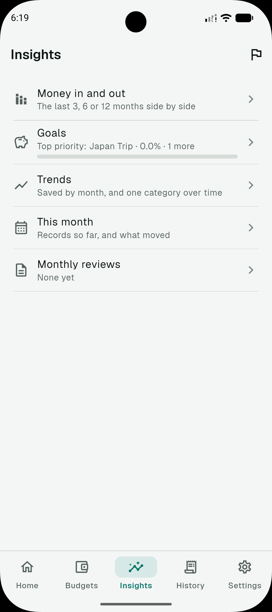 | 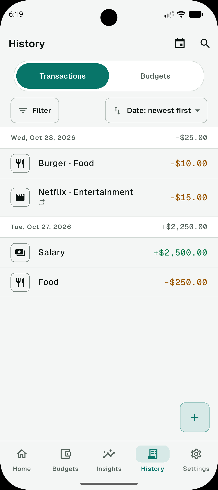 | 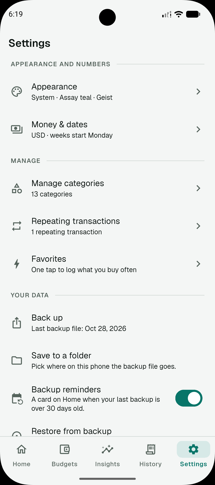 |

<details>
<summary>iPhone</summary>

| Budgets | Insights | History | Settings |
|---------|----------|---------|----------|
| 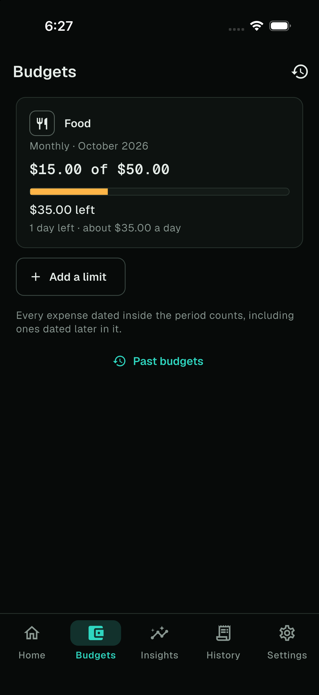 | 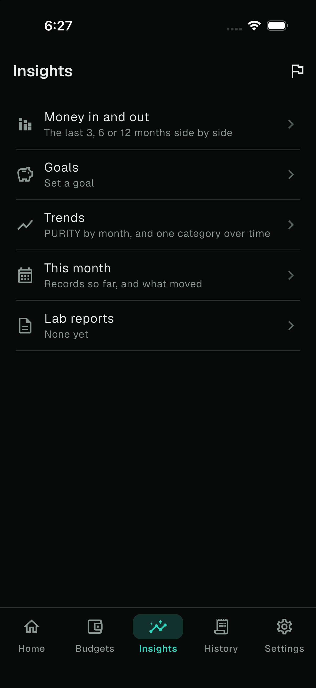 | 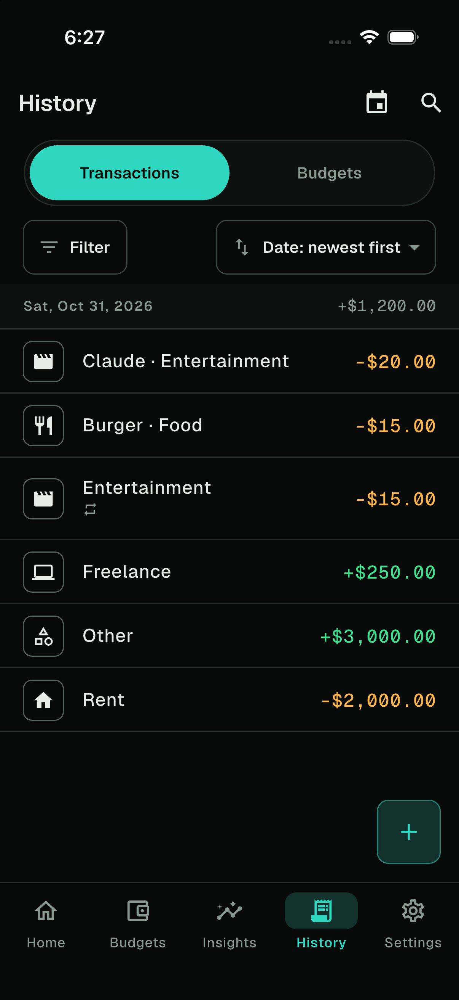 | 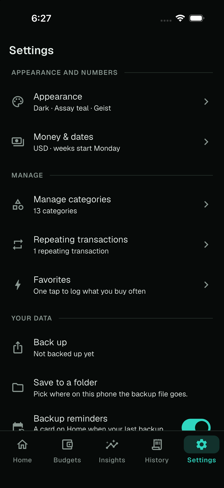 |

</details>

<details>
<summary>Tablet</summary>

| Home | Budgets | Insights | History | Settings |
|------|---------|----------|---------|----------|
| 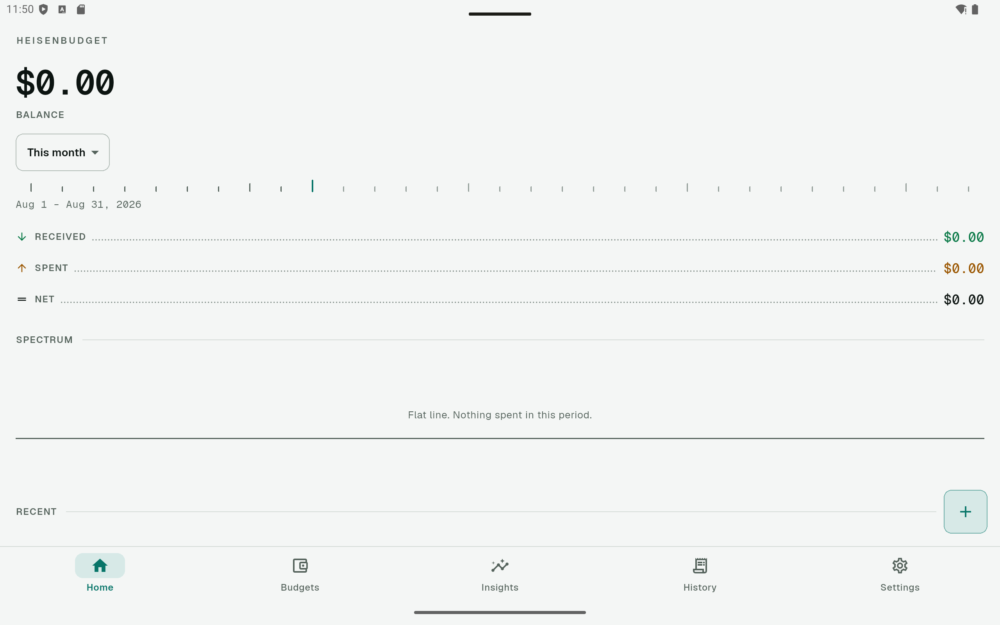 | 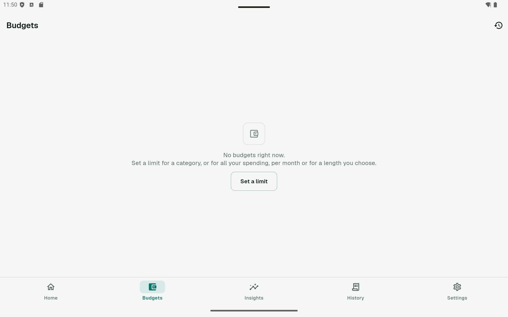 | 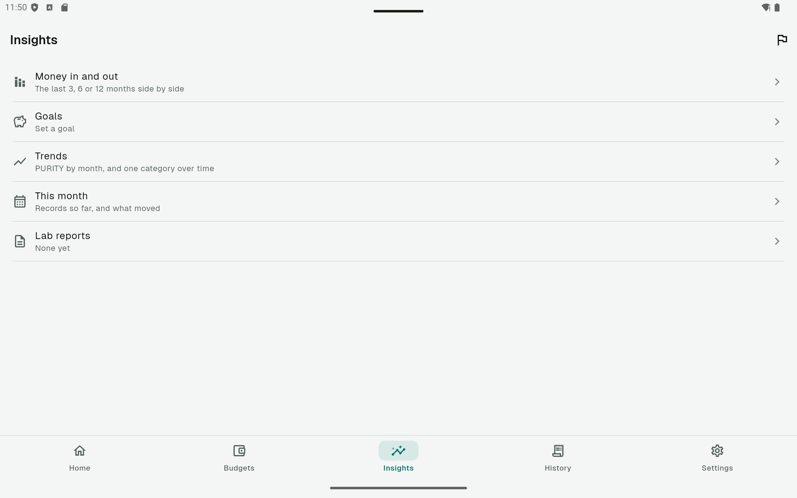 | 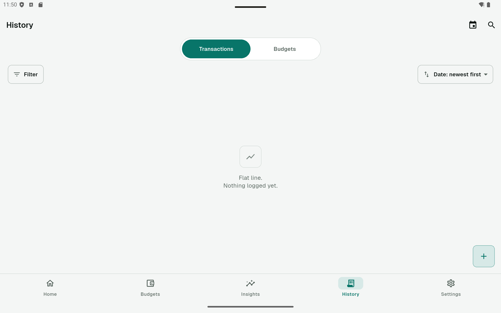 | 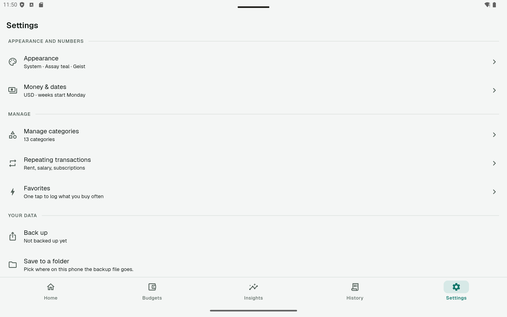 |

</details>

---

## Features

- **Home**: Your balance and Received / Spent / Net for a period you choose from one compact menu: this week, this month, Week 1 to N of a month, or a custom date range. A quiet "vs last month" line sits under Spent and Received (while a period is going it compares the same days). A calm "instrument" look: ruled readouts in tabular mono numbers, a tick ruler and a spectrum chart of spending by category (tap a peak, then "See transactions" opens History on that category and period, or "See trend" opens its trend).
- **Add and edit**: Income and expenses from a bottom sheet (amount, date, category, optional title and note; `1,234.56` is understood), with **Save and add another** for a run of receipts, a prompt before a typed entry is discarded, and swipe to delete with Undo. Press and hold a transaction for Edit, Duplicate, Save as favorite and Delete.
- **Categories**: Every category has an icon, picked from about 240 built-in Material icons in labelled sections with a search box. Change any of them, make your own, archive and restore, or **merge** one into another (its transactions, repeating transactions, favorites and budget limit move over).
- **Favorites**: A Quick add row at the top of the Add sheet: tap one to log it dated today (with Undo), or press and hold to fill the form and change it first. A favorite can leave the amount empty to be asked each time. Manage and reorder them under Settings > Manage > Favorites.
- **Repeating transactions**: Turn on Repeat in the Add sheet (weekly, monthly, yearly or every N days, optionally ending on a date) for rent, pay or a subscription. The app adds each one on its due date when it opens, with an Undo, never ahead of time. Pause, skip or edit them under Settings > Repeating transactions; Home shows what is due in the next 7 days, and **Upcoming** lists everything planned for the next 30, 60 or 90 days (a plan only: nothing in it counts in your balance). Editing a rule only changes what is added from then on.
- **History**: Grouped by day. Filter by type, category, date (All time, this week, this month, last month, custom) and amount range, sort, and search by title, note, category or amount. Matches are highlighted and a results line shows the count and net. "Jump to date" starts a date-sorted list from a day you pick. Filters you use often can be saved under a name (up to 20) and brought back in one tap.
- **Budgets**: A limit for any expense category and, if you like, one for all spending, per month or a custom length (1 to 365 days, or 1 to 60 months; quick picks for a week, a quarter, a year or the rest of this year; repeating by default, or "Just this period" for a one-time budget). **Set several limits** picks monthly limits for many categories at once, filled in from the last three months. The Budgets tab shows the current period of each: a bar, what is left (or "Over by"), the days left and about how much a day. A bar becomes striped and red when over, and "Almost" shows from 80 percent, so it never relies on colour. Changing a limit applies from the current period on and never rewrites earlier ones. "Use the average of the last 3 months or periods" suggests an amount. Saving an expense that takes a budget over its limit says so, and Home has one line ("2 over budget", "All within budget").
- **Past budgets**: History has a **Transactions | Budgets** switch. The Budgets side lists every finished period, newest first, grouped by month, each showing the limit in force then and "Under by", "Over by" or "Used it all". A budget that has ended shows "Copy forward"; one that ran over in at least half of its last few periods says "Usually runs over by ...".
- **Savings goals**: A name, a target, an optional date and an icon. Put money in or take it out with dated entries. Each shows how far along it is, the pace of the last three months and when that reaches the target, and what a target date asks of each month. Goals are numbered by priority (1 is the top; drag to reorder), up to 20 at a time that are not yet reached, and are kept apart from your balance: they never count as spending.
- **Insights**: A tab with a row to each page: **Money in and out** (the last 3, 6 or 12 months as peaks, with a "Show as a list" view), **Goals**, **Trends** (the share kept each month, one category over time), **This month** (biggest expense, busiest day, days with no spending, and what moved most against the months before) and the **month-end reports**. Months follow the "month starts on" setting, like budgets.
- **Month-end report**: A "Lab report" ("Month in review" with Lab flavor off) for each finished month: what came in and went out against the month before, how each budget did (with Adjust or Copy forward), what moved, the five biggest expenses, how the month ran, what went into each goal, and a few next steps (a limit for a big category with none, a goal left alone, a backup if there is no recent one). Home announces it for the first week of a new month and keeps a quiet row to it for the rest of the month; earlier ones are on a Reports page. The top of a report (the month, what came in and went out, the share kept) can be shared as a picture. It only remembers which report you last opened, on this phone.
- **Backup and restore**: Save everything (transactions, categories, budgets, repeating transactions, favorites, goals and settings) to one JSON file, restore it later or on a new phone, or export transactions as a CSV for a spreadsheet. The app only creates the file and opens the phone's share sheet or save dialog; where it goes is your choice. Restoring checks the whole file first, shows what it holds (counts and the dates it covers) beside what is on the phone, and replaces everything only if it is valid. Home shows a quiet reminder card when the last backup is over 30 days old (or there are 10 or more transactions and none was ever made), with Back up now, Remind me later and Stop reminding me. It is only a card: no notification and no permission.
- **Safe updates**: Before an update that changes how data is stored, the app keeps one private copy of the database for 14 days. If the data cannot be opened, a recovery screen offers: try again, restore that copy, restore a backup file, or erase and start over.
- **Home-screen shortcuts**: Press and hold the app icon for Add expense or Add income (and one for your first favorite).
- **Appearance and settings**: Light, dark or follow the phone; five accent colours; four text fonts (Geist, Inter, Atkinson Hyperlegible, System; numbers are always Geist Mono); and a **Lab flavor** switch for the playful wording (it changes words only, never layout or behaviour). Currency from a searchable list (including BDT ৳), opening balance, calendar weeks or fixed 7-day blocks, which weekday a week starts on, and the day a budget month starts (1 to 28). **Erase everything** asks twice and offers a backup first.
- **About**: The app name, version, a short description, the privacy policy address (with a Copy link button; the app itself never goes online), how your data is kept, and a page of open-source licences.

---

## Development

### Requirements

| Tool | Version |
|------|---------|
| Flutter SDK | 3.x (stable channel), Dart ^3.13.5 |
| Android: Java | JDK 21 for the verified Gradle build; Java 17 bytecode target |
| iOS: Xcode | A current Xcode on a Mac (deployment target iOS 15) |

### Quick Start

```bash
# 1. Clone
git clone https://github.com/ajwadtahmid/heisenbudget.git
cd heisenbudget

# 2. Install dependencies
flutter pub get

# 3. Generate the database code (drift)
dart run build_runner build --delete-conflicting-outputs

# 4. Run (Android emulator or device, or an iPhone on a Mac)
flutter run
```

There is nothing to configure: no API keys, no server and no `.env` file.

### Test it

```bash
flutter analyze
flutter test --concurrency=4
```

The whole suite runs offline. A release check test fails if the manifest asks for the `INTERNET` permission, if a networking, analytics or font-download package is added, or if `lib/` touches the network.

### Build a release

The app id is `com.ajwadtahmid.heisenbudget` (Android application id and iOS bundle identifier).

**Android**

```bash
cp android/key.properties.example android/key.properties   # then fill it in (git-ignored)
tools/build_play_bundle.sh
# build/app/outputs/bundle/release/app-release.aab, and build/symbols/<version>
```

Without `android/key.properties` a release build is signed with the debug key, which Play refuses. The script also fails if the merged release manifest asks for the INTERNET permission. Keep `build/symbols/<version>` for every release you publish: crash reports cannot be read without it.

For Google Play the bundle is also built by GitHub Actions: push a tag that matches `pubspec.yaml` (for example `v1.0.0` for `version: 1.0.0+1`) and `.github/workflows/build-release.yml` runs the tests, builds the obfuscated bundle and drafts a release with the `.aab`. It needs four repository secrets (`KEYSTORE_BASE64`, `KEY_ALIAS`, `KEY_PASSWORD`, `STORE_PASSWORD`; the top of the workflow says how to make them) and keeps the debug symbols as a private artifact for 90 days.

**iOS** (needs a Mac with Xcode)

```bash
flutter pub get
# Generate Flutter/Xcode configuration and resolve Swift package integration.
flutter build ios --config-only --no-codesign
open ios/Runner.xcworkspace      # set your Team under Signing & Capabilities
flutter build ipa --release --obfuscate --split-debug-info=build/symbols/<version>   # for the App Store
```

This project uses Flutter’s Swift Package Manager integration (`FlutterGeneratedPluginSwiftPackage`); it has no Podfile. See the [Flutter Swift Package Manager setup](https://docs.flutter.dev/packages-and-plugins/swift-package-manager/for-app-developers). These commands require validation on a Mac before release.

`ITSAppUsesNonExemptEncryption` is set to false because the app has no encryption of its own. If encryption is added (locked backups, an encrypted database), decide the export-compliance answer again.

### Project layout

```
lib/
  app_bootstrap.dart   opens the data before the app starts (or shows recovery)
  core/        constants, theme, design widgets, money parser, formatters
  data/        drift database (schema, start-up check, safety copy), repositories
               (transactions, categories, settings, repeating rules, favorites,
               budgets, savings goals), the recurring catch-up service, backup (file
               format, restore, CSV, share sheet and file picker)
  domain/      pure Dart: DateRange and Period math, budget periods, repeat
               schedules, search matching, summaries, sort options, trends,
               the month-end report and savings goals
  providers/   Riverpod providers (no code generation)
  features/    shell, home, budgets, history, transaction_form, favorites,
               goals, trends (Insights, its pages and the report), settings,
               welcome, recovery, shared widgets
test/          mirrors lib/
tools/         icon scripts and the Play Store bundle script
drift_schemas/ the frozen database schema (a migration test reads it)
```

Only `drift` generates code (`build_runner`); Riverpod is written by hand.

### Money and dates

- Amounts are stored as integer cents, never as floating point numbers.
- Dates are date-only text (`yyyy-MM-dd`), so there are no timezone or daylight-saving surprises.
- A balance counts transactions dated today or earlier; future-dated ones appear in period totals and History but join the balance when their day arrives.
- Amounts are typed without thousands separators: `1234.56` or `1234,56`.

---

## Data & Privacy

- **No login, no account.** Nothing to sign up for and nothing to sign in to.
- **No network.** The app does not ask for the internet permission, and has no analytics SDK, no advertising ID and no crash-reporting service. Heisenbudget never sends anything anywhere: no server, no third-party service.
- **Stored on your device.** Your transactions, categories, budgets, goals, favorites, repeating rules and settings live in a local database and preferences, and the app never uploads them.
- **They leave the phone in two ways.** When you export a backup or a CSV (you choose where it goes), and through your phone's own backup, which the app does not control:
  - **Android:** if Google's automatic backup is on, the app's database and preferences can be copied to your Google account and restored on a new phone.
  - **iPhone:** if iCloud Backup (or a computer backup) is on, the app's data is included and restored onto a new device.

  That copy is held by Google or Apple under their terms; the developer cannot see it. Turn the phone's backup off in the phone's settings if you do not want it. Erase everything and deleting the app do not delete older copies in those backups.
- **Backup and CSV files are not encrypted.** App and Android sharing-cache copies expire after about ten minutes while the app runs; expired copies are also cleaned on launch or resume. Cleanup failures during Erase are reported for retry. Files saved to another app or folder and older OS backups are outside this cleanup. Keep the files you keep somewhere you trust.
- **Recovery copies.** A pre-update copy is pruned on launch once at least fourteen days old. An interrupted restore can retain original files/settings until recovery completes or you confirm Erase.
- **Diagnostics.** App error handlers log event/type information without raw exception text, financial values or database parameters.
- **Privacy policy.** The full policy is published at the address shown in the app's About screen.

---

## Support & Feedback

Have a question or found a bug?

- **Bug reports & feature ideas**: Open a [GitHub Issue](https://github.com/ajwadtahmid/heisenbudget/issues).

---

## Changelog

Full release history and notes are on the [GitHub Releases](https://github.com/ajwadtahmid/heisenbudget/releases) page. The newest is always at [releases/latest](https://github.com/ajwadtahmid/heisenbudget/releases/latest).

---

## Credits & Acknowledgments

- Fonts: [Geist and Geist Mono](https://vercel.com/font), [Inter](https://rsms.me/inter/) and [Atkinson Hyperlegible](https://www.brailleinstitute.org/freefont/), all bundled under the SIL Open Font License (the licences are on the app's licence page). Nothing is downloaded.
- Icons: the Material icons that ship with Flutter.
- Built with [Flutter](https://flutter.dev), [Riverpod](https://riverpod.dev), [drift](https://drift.simonbinder.eu) (SQLite), `shared_preferences`, `intl`, `share_plus`, `file_picker` and `quick_actions`.

**AI assistance:** Heisenbudget is built with the help of AI coding tools (Claude Code). The features, design and testing are directed and checked by the maintainer. The logo started as an AI-generated image and was redrawn as a vector.

---

## FAQ

**Q: Is this app affiliated with any TV show?**
No. It is an independent project, and the name is a pun on a physicist's name. It does not use any show's logo, lettering, characters or quotes.

**Q: Do I need an account?**
No. There is nothing to sign up for. Open the app, optionally enter an opening balance, and start adding transactions.

**Q: Does it need the internet?**
No. The app does not ask for the internet permission, so it cannot go online. Turn on airplane mode and it works the same.

**Q: Where is my data stored?**
On your phone, in a local database. The only other places it can end up are a backup file you make and send, and your phone's own Google or iCloud backup if you have that switched on. See [Data & Privacy](#data--privacy).

**Q: How do I move to a new phone?**
Back up from Settings > Your data and restore the file on the new phone. Restoring checks the whole file first, so a damaged file changes nothing. Your phone's own backup may also bring the data across.

**Q: Are backups encrypted?**
No. A backup is a plain JSON file and a CSV is a plain spreadsheet file. Keep them somewhere you trust.

**Q: How is the balance worked out?**
Opening balance, plus income, minus expenses dated today or earlier. The opening balance is never counted as Received. A transaction dated in the future shows in period totals and History and joins the balance when its day arrives.

**Q: What is "purity" or "Saved"?**
The share of what you received that you kept: Net divided by Received for the period. With Lab flavor on it is called purity; with it off the same figure says "Saved".

**Q: What does Lab flavor change?**
Only words: a few playful names such as the readouts and the month-end report. Never layout or behaviour. Turn it off under Settings > Appearance for plain wording. The list of what it changes is on that page.

**Q: How do budgets work when I change a limit?**
The change applies from the current period on and never rewrites earlier ones, so past periods keep showing the limit that was in force then. "Stop this budget" ends it.

**Q: What is a "month"?**
A budget month, which starts on the day you choose under Settings > Money & dates (1 to 28). Budgets, trends and the month-end report all use it.

**Q: Do goals change my balance?**
No. Goals are tracked separately: putting money in or taking it out of a goal never creates a transaction or changes Spent, budgets or your balance. Reached is worked out from the entries, so taking money out can bring a goal back.

**Q: What decides a goal's order?**
Its place in the list is its priority. The Goals page numbers goals from 1, and the one in first place shows on the Insights tab. Drag the handles to change it.

**Q: Why are repeating transactions only added when I open the app?**
The app has no background service and asks for no permissions, so it adds what is due each time it opens, dated on its due day, and never ahead of time.

**Q: Can I use more than one currency?**
One currency at a time, chosen under Settings > Money & dates. Changing it changes how amounts are shown, not the numbers themselves.

**Q: What platforms are supported?**
Android and iOS.

**Q: How do I delete everything?**
Settings > Your data > Erase everything. It asks twice, offers a backup first, and then clears all data and starts the welcome tour again. Copies in your phone's own backup are not deleted.

---

## Known Limitations

- **One currency and one set of books.** There are no multiple accounts yet; they are planned for later.
- **English only.** Dates and numbers read the same on every phone, whatever its language.
- **No sync between devices.** Move data with a backup file (or your phone's own backup).
- **Backups are not encrypted.** Keep the files somewhere you trust.
- **Phone backups.** If Google's or iCloud's backup is on, it may keep a copy of the app's data that the app cannot delete.
- **Repeating transactions** are added when the app opens, not in the background.
- **Backup reminders** are a card on Home only: no notification.
- **Tablets.** The app runs on tablets and iPads, but its layout is the phone layout, stretched.
